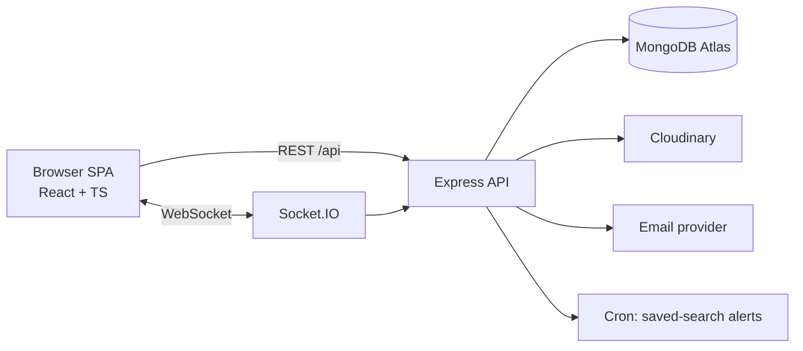

# Build Plan — Real Estate Listing Portal ("Haven")

**Assignment:** Project 8 — Real Estate Listing Portal
**Version:** 1.0
**Date:** November 20, 2026
**Design spec:** [`design.md`](./design.md) — this plan is the implementation companion; all visual, layout, state, and accessibility decisions defer to it.
**Stack:** React + TypeScript + Vite, Node.js + Express, MongoDB (Mongoose), Leaflet (Google Maps optional), Tailwind CSS + shadcn/ui, react-toastify, Framer Motion, JWT auth.

---

## 1. Scope

### 1.1 What ships in v1

| # | Feature | Source in `design.md` |
| --- | --- | --- |
| 1 | Property listings with gallery and full detail page | §7.4 |
| 2 | Search by city, price, type, size with filters + map view | §7.2, §7.3, §8.3 |
| 3 | Favorites with optimistic add/remove | §7.5 |
| 4 | Saved searches with alert preferences | §7.6 |
| 5 | Agent inquiry form and 1:1 chat | §7.8 |
| 6 | Agent dashboard, listing wizard, leads inbox | §7.11 |
| 7 | Admin approval queue, moderation, audit log | §7.12 |
| 8 | Auth (buyer/agent/admin), role-based dashboards | §7.9, §7.10 |
| 9 | Static pages: About, Contact, FAQ, 404/500 | §7.13 |

### 1.2 Explicitly out of scope for v1

Payments/mortgage tools, native apps, multi-language/multi-currency UI, public agent reviews, group chat, and file sharing beyond images/PDF in chat. Keep schema fields (`price`, `rating`) reserved but do not build UI for them.

### 1.3 Demo-critical subset (if time is short)

Auth → catalog search with filters → property detail → favorite → inquiry → agent listing wizard → admin approve. Map view, chat, and saved-search alerts are the first things to defer; they are the highest-effort, lowest-demo-value slices.

---

## 2. Stack decisions

| Layer | Choice | Notes |
| --- | --- | --- |
| Frontend | React 18 + TypeScript + Vite | Route-based code splitting; SPA with prerender for public pages at the end of the project. |
| Routing | React Router v6 | Data-router loaders optional; TanStack Query remains the data layer. |
| Server state | TanStack Query v5 | Query keys include every filter param; optimistic favorite mutations. |
| Client state | Zustand | Auth session, UI prefs (grid/list, filters-open, map viewport), reduced-motion override. |
| Styling | Tailwind CSS 3 + design tokens from `design.md` §14 | Token CSS variables + Tailwind extension in §4 of this plan. |
| Components | shadcn/ui (Radix primitives) | Themed to Haven tokens; no default shadcn colors. |
| Forms | React Hook Form + Zod | Shared Zod schemas on client and server where possible. |
| Toasts | react-toastify | Top-right desktop / bottom-center mobile; themed, `aria-live`, 5s default. |
| Motion | Framer Motion | Central variants module; `useReducedMotion` gate. |
| Icons | Lucide React | 1.75px stroke, 20px default. |
| Carousels | Embla Carousel | Featured listings and gallery. |
| Lightbox | `yet-another-react-lightbox` | Keyboard + focus trap; restyle to ink background. |
| Charts | Recharts (agent/admin analytics only) | Accessible table fallback. |
| Maps | Leaflet + react-leaflet + `leaflet.markercluster` | CARTO Positron tiles; `divIcon` price pills; Google Maps behind a provider interface (optional). |
| API | Node.js + Express + TypeScript | Layered: routes → controllers → services → models. |
| DB | MongoDB + Mongoose | `2dsphere` for bounds/near queries; text index for keyword search. |
| Auth | JWT access (in memory) + rotating refresh (HttpOnly cookie) | bcrypt/argon2 hashing; rate-limited auth endpoints. |
| Realtime | Socket.IO | Chat only; polling fallback on disconnect. |
| Media | Cloudinary (or S3 + sharp) | Signed direct uploads; three derivatives; no binaries in Mongo. |
| Validation | Zod (request bodies/query) + Mongoose validation | Reject unknown fields; strip HTML. |
| Email | Nodemailer (dev: Mailtrap) → Resend/SES in prod | Inquiry, listing decision, saved-search digest. |
| Testing | Vitest + RTL, Supertest + `mongodb-memory-server`, Playwright, axe | See §14. |
| Deploy | Vercel/Netlify (client), Render/Railway (API), Atlas (DB), Cloudinary | Env vars only; CORS allowlist. |

---

## 3. Architecture



- One repository with `client/` and `server/`; shared `shared/` types package (or path alias) for DTOs and Zod schemas.
- API responses use `{ data, meta }`; errors use `{ error: { code, message, details? } }` (`design.md` §15.3).
- Every protected route runs `requireAuth` → `requireRole` → ownership assertion.
- Images never proxied through the API; only signed upload params and validated metadata.

---

## 4. Design system setup (do this first)

1. Copy tokens from `design.md` §14 into `src/styles/tokens.css`.
2. Add the Tailwind extension from `design.md` §14 (`brand`, `ink`, `heading`, `body`, `muted`, `line`, `canvas`, fonts, radii, shadows, containers).
3. Configure shadcn/ui with CSS variables filled from the Haven palette so primitives inherit the design:

| shadcn variable | Haven value | HSL triple for shadcn |
| --- | --- | --- |
| `--background` / `--card` | `#FFFFFF` | `0 0% 100%` |
| `--foreground` / `--heading` | `#1F2A33` | `207 24% 16%` |
| `--muted-foreground` / `--body` | `#5B6770` | `206 10% 40%` |
| `--muted` | `#F6F8F9` | `200 20% 97%` |
| `--border` / `--input` | `#DCE0E0` | `120 6% 87%` |
| `--primary` | `#0077B6` (buttons) | `201 100% 36%` |
| `--primary-foreground` | `#FFFFFF` | `0 0% 100%` |
| `--ring` | `#00AEFF` | `199 100% 50%` |
| `--destructive` | `#DC3545` | `354 70% 54%` |
| `--destructive-foreground` | `#FFFFFF` | `0 0% 100%` |

4. Add brand-only tokens: `--brand`, `--brand-strong`, `--brand-soft`, `--ink`, `--success`, `--warning`, `--success-tint`, `--warning-tint`, `--danger-tint`, `--warning-text` (`#7A5200`).
5. Typography: load Roboto 400/500/600/700 and Roboto Slab 600/700 with `font-display: swap`; apply `font-variant-numeric: tabular-nums` to prices, stats, tables.
6. Toast defaults in `main.tsx`: container position responsive via a `useMediaQuery`, theme `light`, autoClose 5000 (errors 8000), `newestOnTop`, `aria-live: polite`, limit 3.
7. Motion module `lib/motion.ts`: durations 150/200/300 and `cubic-bezier(.22,1,.36,1)`; variants for card hover (2px lift + shadow), drawers (x slide), sheets (y slide), page fade. `useReducedMotion` swaps transforms for opacity.
8. Global focus style: 2px `--brand` ring with 2px offset; never remove outlines.
9. Verify tokens visually on Button, Input, Badge, Card, Dialog before building pages.

---

## 5. Roles and permissions

| Capability | Guest | Buyer | Agent | Admin |
| --- | --- | --- | --- | --- |
| Browse/search/view approved listings | Yes | Yes | Yes | Yes |
| View pending/rejected listing | No | No | Own only | Yes |
| Favorite / saved search / inquiry | Prompt login | Yes | Yes | Yes |
| Chat with agent | No | Yes (about listings) | Yes (own leads) | Yes |
| Create/edit listing | No | No | Own, non-archived | Any |
| Submit listing for review | No | No | Own | N/A |
| Approve/reject/request changes | No | No | No | Yes |
| Manage users, suspend agents | No | No | No | Yes |
| View audit log | No | No | No | Yes |

Guests may store favorites locally and merge them on login (feature-flagged; default on).

---

## 6. Data model

Extends `design.md` §15.1. All schemas use `timestamps: true`, snake-free camelCase, and `toJSON` transforms that strip internals (`passwordHash`, `__v`).

| Collection | Key fields |
| --- | --- |
| `User` | name, email (unique, lowercase), phone, passwordHash, role (`buyer`\|`agent`\|`admin`), status (`active`\|`suspended`), avatar {url, publicId}, emailVerifiedAt, lastLoginAt |
| `RefreshToken` | user, tokenHash, userAgent, ip, expiresAt, revokedAt |
| `AgentProfile` | user (1:1), agency, bio, licenseNumber, verified, serviceAreas[], responseTimeMinutes, ratingAvg, ratingCount, memberSince |
| `Property` | title, slug (unique), description (sanitized HTML), listingType (`sale`\|`rent`), propertyType (apartment, house, villa, studio, condo, office, shop), price, rentPeriod (`monthly`\|`weekly`\|`nightly`), pricePerSqft (computed), beds, baths, garages, sizeSqft, lotSizeSqft, yearBuilt, address {street, city, state, zip, country, neighborhood}, location {type: "Point", coordinates: [lng, lat]}, amenities[], images [{url, publicId, alt, isCover, order}], agent, status, featured, featuredUntil, views, rejectionReason {category, note}, reviewedBy, reviewedAt, publishedAt, archivedAt |
| `Favorite` | user, property, createdAt — unique `{user, property}` |
| `SavedSearch` | user, name, criteria (query snapshot), alertFrequency (`off`\|`instant`\|`daily`\|`weekly`), channels (`email`, `inApp`), lastRunAt, lastMatchCount, createdAt |
| `Inquiry` | property, buyer, agent, name, email, phone, message, tourDate, consent, status (`new`\|`contacted`\|`qualified`\|`closed`\|`spam`), notes[] |
| `Conversation` | participants [user, agent], property, lastMessageAt, lastMessagePreview, unreadCounts {userId: n} |
| `Message` | conversation, sender, body, attachments[], readBy[], createdAt |
| `Notification` | user, type, payload, readAt |
| `AuditLog` | actor, action, entity, entityId, before, after, reason, ip, createdAt |

Indexes:

- `Property`: `{status:1, listingType:1, propertyType:1, price:1}`, `{status:1, publishedAt:-1}`, `{featured:1, status:1}`, `{"address.city":1}`, `{"address.neighborhood":1}`, `{location:"2dsphere"}`, text index on `title`, `description`, `"address.city"`, `"address.neighborhood"`, `{agent:1, status:1}`.
- `Favorite`: unique `{user:1, property:1}`; `{property:1}` for counts.
- `Message`: `{conversation:1, createdAt:1}`.
- `Inquiry`: `{agent:1, status:1, createdAt:-1}`.
- `AuditLog`: `{entity:1, entityId:1, createdAt:-1}`, `{createdAt:-1}`.

Schema rules:

- Slug is generated from title + city and made unique with a numeric suffix; never regenerated after publish.
- `pricePerSqft` computed in a pre-save hook for sales only; `rentPeriod` required for rentals.
- `location` required before submit-for-review; geocode on save, allow manual pin adjustment.
- `images` min 3 / max 20 enforced at the submit step, not while drafting.

### 6.1 Lifecycle

```
draft -> pending -> approved -> archived
                 -> changes_requested -> pending
                 -> rejected -> draft (optional)
```

- Public search/detail returns only `approved` and non-archived listings.
- Owner and admin can preview any status with a status banner.
- Editing material fields (title, price, address, photos, type, size) on an approved listing returns it to `pending`; cosmetic fields (description typo, amenities order) may skip re-review via a `materialChange` check.
- Every transition writes an audit entry with actor, timestamp, before/after, and reason.
- Rejection and changes-requested require a category (`incomplete_information`, `poor_photos`, `inaccurate_pricing`, `duplicate`, `policy_violation`) plus an optional note delivered to the agent.

---

## 7. API surface

Auth uses `/api`. All list endpoints accept `page`, `limit` (default 24, max 60), and return `meta.total`.

### Auth & account

| Method | Endpoint | Purpose |
| --- | --- | --- |
| POST | `/api/auth/register` | Buyer or agent registration (agent adds agency, license) |
| POST | `/api/auth/login` | Access + refresh; sets cookie |
| POST | `/api/auth/refresh` | Rotate refresh token |
| POST | `/api/auth/logout` | Revoke refresh token |
| GET | `/api/auth/me` | Current user + agent profile |
| POST | `/api/auth/forgot-password` / `reset-password` | Reset flow |
| PATCH | `/api/account/profile` | Name, phone, avatar, notification prefs |
| PATCH | `/api/account/password` | Change password |

### Properties (public + agent)

| Method | Endpoint | Purpose |
| --- | --- | --- |
| GET | `/api/properties` | Search: q, listingType, propertyType, city, neighborhood, minPrice, maxPrice, beds, baths, minSize, maxSize, amenities, featured, sort, page, limit, bounds |
| GET | `/api/properties/:slug` | Detail (status-gated) |
| GET | `/api/properties/:slug/similar` | Same city/type, ±20% price |
| GET | `/api/agents` / `/api/agents/:id` | Directory + profile |
| GET | `/api/locations/cities` | City list with counts (for combobox) |
| GET | `/api/locations/suggest?q=` | City/neighborhood autocomplete |
| GET | `/api/properties/mine` | Agent's listings, any status |
| POST | `/api/properties` | Create draft |
| PATCH | `/api/properties/:id` | Update own draft/changes-requested |
| POST | `/api/properties/:id/submit` | Validate + submit for review |
| POST | `/api/properties/:id/archive` | Archive |
| DELETE | `/api/properties/:id` | Drafts only |

### Favorites, saved searches, inquiries, chat

| Method | Endpoint | Purpose |
| --- | --- | --- |
| GET | `/api/favorites` | List with property summaries |
| POST | `/api/favorites/:propertyId` | Add (idempotent) |
| DELETE | `/api/favorites/:propertyId` | Remove |
| GET/POST | `/api/saved-searches` | List / create from current criteria |
| PATCH/DELETE | `/api/saved-searches/:id` | Edit alerts / delete |
| GET | `/api/saved-searches/:id/matches` | Preview current matches |
| POST | `/api/inquiries` | Send inquiry (rate-limited) |
| GET | `/api/inquiries` | Agent/admin inbox with filters |
| PATCH | `/api/inquiries/:id` | Status, notes |
| GET | `/api/conversations` | List with unread counts |
| POST | `/api/conversations` | Get-or-create by (buyer, agent, property) |
| GET | `/api/conversations/:id/messages` | Paginated history |
| POST | `/api/conversations/:id/messages` | Send (also emits via Socket.IO) |
| POST | `/api/conversations/:id/read` | Mark read |

### Admin

| Method | Endpoint | Purpose |
| --- | --- | --- |
| GET | `/api/admin/stats` | KPIs (pending, live, new users 7d, open inquiries) |
| GET | `/api/admin/listings` | Search all, any status |
| PATCH | `/api/admin/listings/:id/status` | Approve / reject / request changes (reason required for negative) |
| POST | `/api/admin/listings/bulk-approve` | Clean listings only |
| GET | `/api/admin/users` | Users with role/status filters |
| PATCH | `/api/admin/users/:id/status` | Suspend/reactivate with reason |
| PATCH | `/api/admin/agents/:id/verify` | Verification toggle with note |
| GET | `/api/admin/audit` | Audit log with filters |
| POST | `/api/uploads/sign` | Signed Cloudinary upload params |

Search params and `sort` values follow `design.md` §15.3 exactly (`newest`, `price_asc`, `price_desc`, `size_desc`).

---

## 8. Frontend build plan

Route map comes from `design.md` §6. Build in this order so every phase is demoable.

### 8.1 Shell and shared UI

- `AppShell`: utility bar (40px), sticky header (80px, transparent on home until 32px scroll), footer (`design.md` §5.4–5.5).
- Header: logo, Buy/Rent/Agents/Explore, Favorites count, "List a property", avatar menu. Mobile drawer with focus trap and Escape close.
- Shared components: Button, Input, Textarea, Select/Combobox, Checkbox, Chip, Badge, Tabs, Avatar, Modal, Drawer/Sheet, Tooltip, Accordion, Breadcrumb, Pagination, Skeleton, EmptyState, Stepper, DataTable, FileUploader, StatCard, StatusBadge, PriceText (tabular numerals).
- Property card (`design.md` §8.2): grid + list + compact map popup variants; image 4:3, status badges, heart, price, title, address, meta row, agent row; hover lift; "New" under 7 days; focus-visible ring; skeleton variant.
- Toast integration: every mutation result is specific ("Added to favorites", "Search saved", "Listing submitted for review"); destructive actions use a confirm modal, not a toast.

### 8.2 Public pages

1. **Home** (`design.md` §7.1): hero with image + gradient overlay + SearchBar; featured carousel (Embla, manual arrows only); six property-type tiles; four city tiles; value props; agent spotlight; testimonials; CTA band. Skeleton/fallback behavior per spec.
2. **Search results** (`design.md` §7.2): breadcrumb, title with count, sticky summary bar, active chips, toolbar (count/sort/grid-list-map), 300px filter sidebar (sticky 104px), 3/2/1-column grid, numbered pagination, list variant, mobile bottom-sheet filters with projected count, URL-synced state, empty/loading/error states.
3. **Map search** (`design.md` §7.3): 44/56 split, independent scroll rail, sticky map of `calc(100vh - 80px)`, price-pill `divIcon` markers, clusters, bidirectional hover/focus sync, "Search this area", mobile List/Map segmented control with bottom preview card, tile-failure fallback and screen-reader list.
4. **Property detail** (`design.md` §7.4): mosaic gallery + lightbox, status/featured badges, price and price-per-sqft/rent period, favorite/share/print, key facts bar, sticky tabs, overview/details/amenities/floor plans/map (Leaflet, non-interactive until click)/mortgage estimate/similar, sticky agent card with inquiry form, mobile sticky price bar, JSON-LD, archived/404 states.
5. **Agents** directory + profile (`design.md` §7.7), static pages (§7.13).

### 8.3 Auth and buyer account

- Split auth layout, login/register/forgot/reset, inline Zod validation, password strength, role choice, agent fields, redirect-to-intended.
- Buyer dashboard: sidebar shell (Overview, Favorites, Saved searches, Inquiries, Messages, Profile) with overview cards per §7.10.
- Favorites: optimistic removal with undo toast; empty state; login prompt returns to prior route; guest merge on login.
- Saved searches: cards with criteria chips, match count, alert frequency/channels, Run/Edit/Delete, create from search toolbar, delete confirmation.

### 8.4 Agent dashboard

- Shell + KPIs (active listings, 30-day views, new leads, avg response time), 30-day views/inquiries chart with table fallback, recent leads, pending statuses.
- My listings table (cover, title/address, status chip, price, views, leads, updated, actions) with status filters; edit/preview/archive; delete drafts only.
- Listing wizard (`design.md` §7.11): six steps, horizontal stepper, per-step Zod validation, scroll-to-first-error, autosave draft every 30s and on step change ("Saved just now"), backward navigation safe, submit confirmation, status timeline, changes-requested banner with admin note.
- Leads inbox: table with buyer/property/date/status/last activity; detail with original inquiry, contact info, notes, status control; bulk spam/closed only.
- Analytics: date range 7/30/90, top listings, favorites count.

### 8.5 Admin console

- Overview KPIs + queue preview + activity feed + quick actions.
- Approval queue with tabs and counts; filters; bulk approve; 720px review drawer with gallery, full details, agent history, submission history, audit trail; footer actions with reason modals; optimistic row removal with rollback; empty state.
- Listings management (search, status filter, archive/restore, view public).
- Users/agents tables with suspend/reactivate + reason, agent verification toggle with note.
- Audit log table (actor, action, entity, before → after, reason, time).
- Settings placeholder for review policy.

### 8.6 Motion and interaction rules

- Page transitions: opacity + 8px y-shift, 200ms; dashboard panels: 200ms; drawers/sheets: 300ms spring-free easing.
- Card hover: `translateY(-2px)` + shadow sm→md + image `scale(1.04)` (image wrapper `overflow: hidden`).
- Favorites heart: 150ms scale pop; disabled under reduced motion.
- Gallery lightbox: fade + scale 0.98→1; focus trap; Escape closes.
- No autoplaying carousels; no animation on tables or long lists; skeletons use shimmer, not spinners.

---

## 9. Search, filters, map (implementation detail)

### 9.1 URL contract

```
/properties?type=sale&propertyType=apartment,house&city=brooklyn
  &minPrice=400000&maxPrice=900000&beds=2&baths=1
  &minSize=800&maxSize=2500&amenities=parking,pool
  &sort=price_asc&page=2&view=map
```

- A single `useSearchParams`-backed `SearchState` parser serializes defaults out of the URL.
- Filters apply on submit on desktop (chips apply immediately); mobile applies via the bottom sheet's sticky button.
- `view=map` toggles the split view; grid/list preference lives in `localStorage` only.
- Back/forward restore filters because the URL is the source of truth. TanStack Query key = normalized search state + bounds + page.

### 9.2 Server query

- Zod-parse params; build `$and` conditions; only `status: "approved"` unless the requester is owner/admin.
- Text search uses the text index for `q` and boosts title matches via `$meta: "textScore"` when sort is relevance (add `relevance` sort only for keyword searches).
- Bounds: `$geoWithin: { $box: [[swLng, swLat], [neLng, neLat]] }`; cap map results at 500 and cluster client-side.
- Aggregate `city` counts for the filter sidebar once per filter set (cache 60s).
- Never trust `limit` above 60; never expose `agent.phone` in list responses.

### 9.3 Map

- Leaflet with CARTO Positron raster tiles + attribution; `divIcon` price pills (`$876K`, `$4.5K/mo`).
- Marker active state = ink fill, white text, scale 1.08, top z-index; card hover/focus sets marker active and vice versa.
- `moveend` debounced 400ms updates "Search this area" affordance only; the query runs on click, not on every pan.
- Fit bounds on first load per result set; preserve viewport when returning from a detail page (Zustand + sessionStorage).
- Cluster click zooms to bounds; popup uses the compact property card.
- Fallback: neutral grid + "Map unavailable" banner; results remain fully usable; screen-reader-only results list always rendered.
- Provider contract: `MapProvider` interface (`render`, `fitBounds`, `setActive`, `onMove`) so Google Maps can be added without touching pages.

---

## 10. Favorites, saved searches, inquiries, chat

- **Favorites**: `useMutation` with `onMutate` cancel + snapshot + optimistic insert/remove; rollback on error; toast with Undo on removal (re-add). Heart state derived from a favorites id set fetched once per session.
- **Saved searches**: save normalized criteria + human-readable chips; match count computed with the same query builder; alert job (`node-cron`, hourly) groups new matches since `lastRunAt` and sends instant/daily/weekly digests idempotently per user/search/day; deep-link opens `/properties?...`.
- **Inquiries**: server validates property is public, prevents self-inquiry, rate-limits per IP+user, stores consent, notifies agent (in-app + email), returns expected response time from `agent.responseTimeMinutes`.
- **Chat**: Socket.IO with JWT handshake auth; room per conversation id; server verifies participation on join; messages persisted before emit; read receipts update `readBy` and unread counts; offline recipients get an email (respect preferences); client reconnects with exponential backoff and refetches the thread on reconnect; typing events are ephemeral.
- **Unread counts** in the header, account menu, and conversation list; cleared on thread open/read.

---

## 11. Auth and security

- Access token (15 min) kept in memory (Zustand, not persisted); refresh token (7 days, rotating) in `HttpOnly; Secure; SameSite=Lax` cookie scoped to `/api/auth`.
- Logout revokes the refresh token server-side; password change and suspension revoke all sessions.
- `bcrypt` (cost 12) or `argon2id`; login/register/forgot/inquiry rate-limited; generic error messages on login.
- Zod validation on body/query/params; reject unknown keys; sanitize rich description HTML with an allowlist (`sanitize-html`).
- `helmet`, CORS allowlist from env, `express.json({limit: "1mb"})`, request IDs, structured logs with redacted tokens/emails.
- Ownership checks on every agent route (`property.agent === req.user.id`); admin bypass only for admins.
- Cloudinary signed uploads with per-folder constraints (format, bytes, count); verify metadata server-side before attaching to a listing.
- Never expose buyer contact data publicly; inquiry endpoints return only to the agent and admin.
- Audit every moderation action and admin user change; logs are append-only from the app's perspective.
- Secrets in env; separate DB users for app and migrations; dependencies audited in CI.

---

## 12. Media and images

- Upload flow: client → `/api/uploads/sign` → direct Cloudinary upload → client submits `publicId`/metadata → server validates.
- Derivative sizes: thumb 400, card 800, hero 1600; `f_auto,q_auto`; WebP/AVIF; `loading="lazy"` + explicit dimensions except the hero and gallery cover.
- Alt text required per image in the wizard (defaults to listing title); broken-image fallback (pale surface + home icon).
- Strip EXIF GPS; max 10MB per file; min 3 photos to submit; max 20.
- Signed delivery for none of the property images (public marketing content); only chat attachments use authenticated delivery.
- Folder convention: `properties/<propertyId>/<uuid>`, `avatars/<userId>`, `chat/<conversationId>`.

---

## 13. SEO and performance

- SPA with prerendered public routes (Vite SSG or a prerender step) for `/`, `/properties`, `/properties/:slug`, `/agents`, `/agents/:id`; meta tags per route via React Helmet Async.
- Canonical URLs, OG images (property cover), `RealEstateListing` JSON-LD with price, address, geo, images, availability.
- Sitemap generated on build from approved listings; robots.txt excludes dashboards.
- Code-split map, lightbox, chat, admin console; prefetch next page on pagination hover; virtualize admin tables above 100 rows.
- Budgets: LCP < 2.5s mobile 4G, CLS < 0.1, INP < 200ms; query p95 < 300ms at 10k listings.
- Skeletons match final layout; no layout shift on images (width/height attributes).

---

## 14. Testing

| Layer | Tool | Coverage |
| --- | --- | --- |
| Unit | Vitest | Price/area formatting, URL serializer, status transition guards, `materialChange` detection, distance/price filters |
| Component | RTL + axe | Property card, filter panel, chips, wizard stepper, grade/review drawer, badges, empty states |
| API | Supertest + `mongodb-memory-server` | Auth rotation, role/ownership enforcement, listing filters, review transitions + audit, favorites idempotency, saved-search match counts, inquiry validation |
| E2E | Playwright | Register → search → open detail → favorite → inquire; agent create → submit → admin approve → public visibility; chat send/receive; saved search create |
| Visual | Playwright screenshots | Card, results grid, detail, approval drawer |
| Manual | Keyboard + NVDA/VoiceOver | Header, filters, gallery/lightbox, map list, chat, wizard, admin table |

Seed script: 1 admin, 3 agents, 2 buyers, 40 approved listings across 4 cities, 5 pending, 3 favorites, 2 conversations.

---

## 15. Delivery plan

Estimates assume one full-stack developer; parallelize client/server if two.

### Phase 0 — Foundation (2 days)

- Repo, TS configs, lint/format, env schema, Mongo connection, health check, error envelope.
- Tokens, Tailwind extension, shadcn theme, fonts, toast container, motion module, focus styles.
- App shell: utility bar, header (transparent→solid), footer, mobile drawer, 404.

**Exit:** shell matches `design.md` §5 at 360px and 1280px; tokens verified on primitives.

### Phase 1 — Auth + roles (4–5 days)

- Register/login/refresh/logout/reset; agent application fields; seed admin.
- Protected route guards, role-based redirects, buyer/agent/admin shells with empty states.
- Profile and password change.

**Exit:** three roles reach their shells; API tests prove role and ownership rejection.

### Phase 2 — Listings, uploads, detail (1.5 weeks)

- Property schema + media uploads; agent wizard steps 1–5 with autosave.
- Submit-for-review validation and status timeline.
- Property detail page with gallery/lightbox, key facts, tabs, agent card, inquiries; similar properties.
- Public home featured sections plus skeleton/fallback.

**Exit:** an agent creates and submits a listing; a buyer opens it via a direct link in preview mode; approved-only visibility enforced.

### Phase 3 — Search, filters, map (1.5 weeks)

- Search API with filters/sort/pagination/bounds + indexes; catalog page with URL state, chips, sidebar, list/grid, pagination, empty/loading.
- Mobile filter bottom sheet.
- Leaflet split view, clusters, price pills, sync, "Search this area", fallback.

**Exit:** filters are shareable and survive back/forward; map and list stay in sync; 10k-row query meets budget.

### Phase 4 — Favorites, saved searches, chat (1 week)

- Favorites optimistic flow + guest merge.
- Saved searches CRUD, match counts, digest job, email template.
- Inquiry inbox; Socket.IO chat with read receipts, typing, unread counts, offline fallback.

**Exit:** E2E favorite → saved search → digest; two browsers exchange chat messages with correct unread state.

### Phase 5 — Admin console (1 week)

- Overview KPIs, approval queue + drawer, reason modals, bulk approve, audit log.
- Users/agents management, suspension effects, verification toggle.
- Listings management and archive/restore.

**Exit:** approve/reject/request-changes updates public visibility immediately and writes audit entries; suspension hides listings.

### Phase 6 — Polish, SEO, QA (1 week)

- Prerender public routes, meta/JSON-LD/sitemap.
- Accessibility sweep, reduced motion, keyboard paths, 200% zoom.
- Performance pass, image budgets, code splitting.
- Seed data, copy pass, Lighthouse targets, cross-browser check.

**Exit:** all acceptance criteria pass; Lighthouse 85+ performance / 95+ accessibility / 95+ best practices / 90+ SEO on public pages.

### 15.1 Milestones

| Milestone | End of phase | Demo |
| --- | --- | --- |
| M1 | Phase 1 | Three dashboards sign in |
| M2 | Phase 2 | Listing detail with gallery + wizard draft |
| M3 | Phase 3 | Filtered search + map split view |
| M4 | Phase 4 | Favorite, saved search email, live chat |
| M5 | Phase 5 | Admin approval end to end |
| M6 | Phase 6 | Polished, indexed, accessible build |

### 15.2 Acceptance criteria

- [ ] Guest can search, filter, open a listing, and is prompted to sign in for favorites/inquiries.
- [ ] Filters, sort, layout, and page sync to the URL; back/forward restores them exactly.
- [ ] Map markers, clusters, popups, and cards highlight in both directions; panning does not refire queries until "Search this area".
- [ ] Favorites update instantly and roll back with a toast on API failure.
- [ ] Saved searches store criteria, show match counts, and send one digest per frequency without duplicates.
- [ ] Inquiry requires consent, blocks self-inquiry, and notifies the agent in-app and by email.
- [ ] Chat delivers in real time, persists history, and shows accurate unread counts; reconnect refetches.
- [ ] Agent wizard validates per step, autosaves, preserves data after errors, and cannot submit with fewer than 3 photos.
- [ ] Non-approved listings never appear in public search, detail, sitemap, or JSON-LD.
- [ ] Admin approve/reject/request-changes writes audit entries and emails the agent; rejection requires a category.
- [ ] Suspended agents are signed out and their listings disappear from public search.
- [ ] Every badge pair meets AA; no white text on `#00AEFF`; 44px targets; visible focus everywhere.
- [ ] Keyboard-only paths pass for header, filters, gallery, chat, wizard, and admin drawer.
- [ ] Reduced motion removes transforms; no autoplaying carousels.

---

## 16. Design QA checklist

Run `design.md` §18 verbatim, plus:

- [ ] Cards show price, status, location, and key facts without interaction; price never truncates.
- [ ] Rental prices show the period everywhere (cards, detail, map pills).
- [ ] Wizard blocks submission with fewer than 3 photos and shows which step failed.
- [ ] Map tile failure leaves search fully usable with the "Map unavailable" banner.
- [ ] Status is conveyed by text, not color alone, in tables, cards, and the review drawer.
- [ ] Reject/request-changes modals require a reason and show the agent-facing note preview.
- [ ] Saved-search digest links open the correct filtered results.
- [ ] Chat system messages (status changes) render distinctly from user messages.
- [ ] No placeholder copy or dead controls remain on production-facing screens.

---

## 17. Risks and decisions

| Risk / decision | Default |
| --- | --- |
| Map provider | Leaflet + CARTO (no key, predictable cost); Google behind the provider contract only if Places is required. |
| Media storage | Cloudinary signed uploads; S3 + sharp if self-hosting. |
| Chat scope | One-to-one buyer↔agent only; no group chat, no attachments beyond images/PDF. |
| Guest inquiries | Disabled; account required to reduce spam (design.md §19 default). |
| Guest favorites | Local storage + merge on login; feature flag to disable. |
| Agent verification | Self-registration allowed; verified badge requires admin toggle; unverified agents can still publish after admin review. |
| Re-review on edit | Material fields only; cosmetic edits publish immediately, and the rule is documented in the wizard. |
| Saved-search mail provider | Mailtrap in dev, Resend in prod; templates share the visual system. |
| Certificates / reviews | Out of scope for this project. |
| Deployment | Static client host + Node API host + Atlas + Cloudinary; confirm before Phase 0. |
| Timeline | Full scope ≈ 6–7 weeks solo; demo subset (Phases 0–3 + admin review) ≈ 3.5 weeks. |